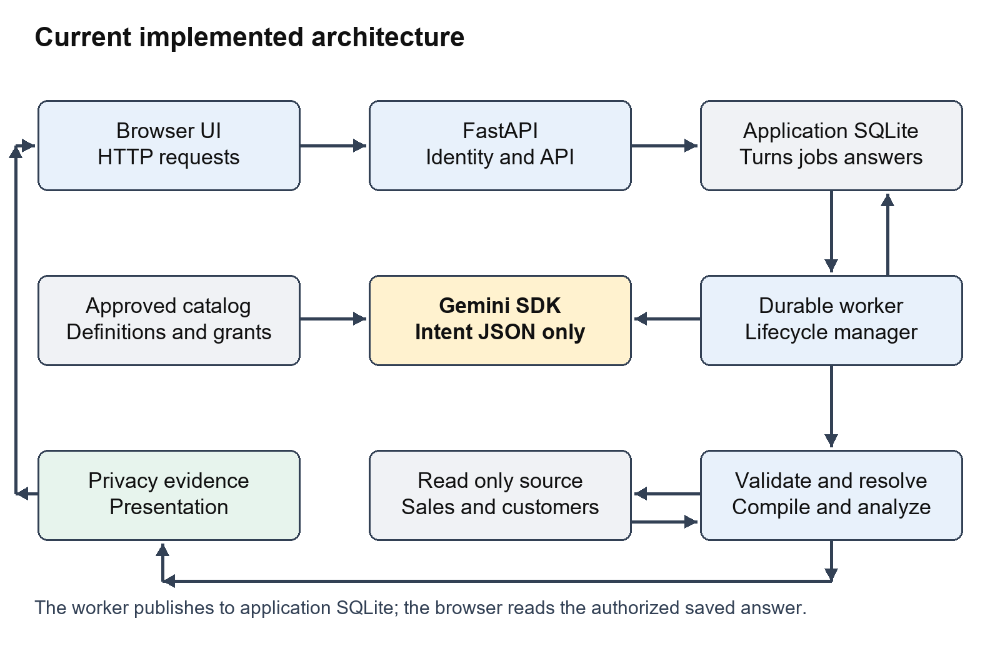
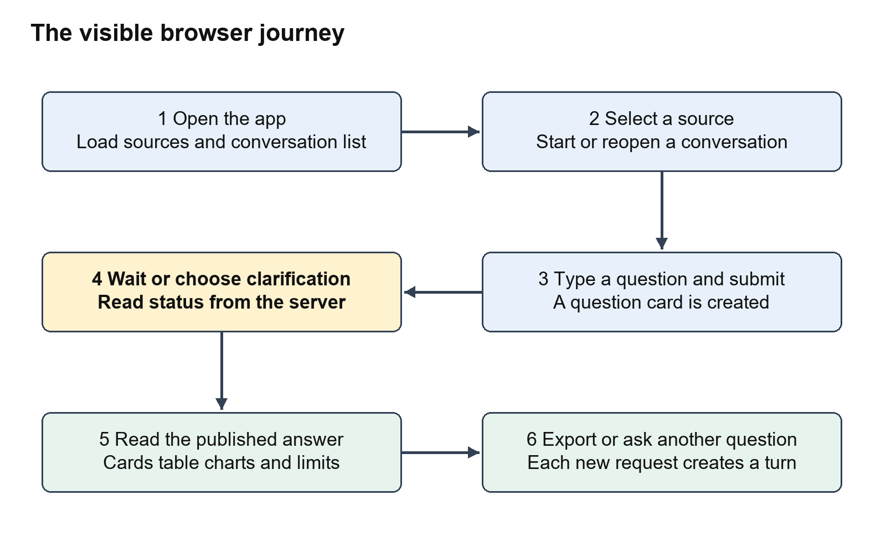
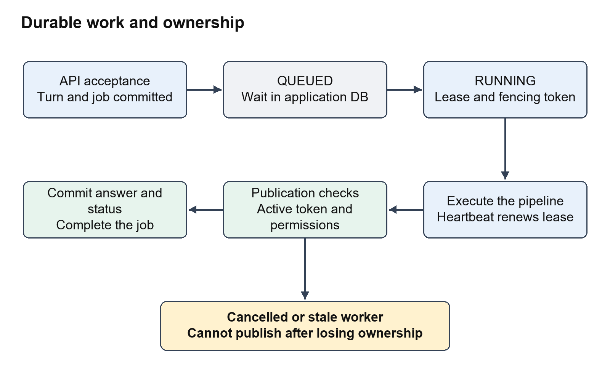
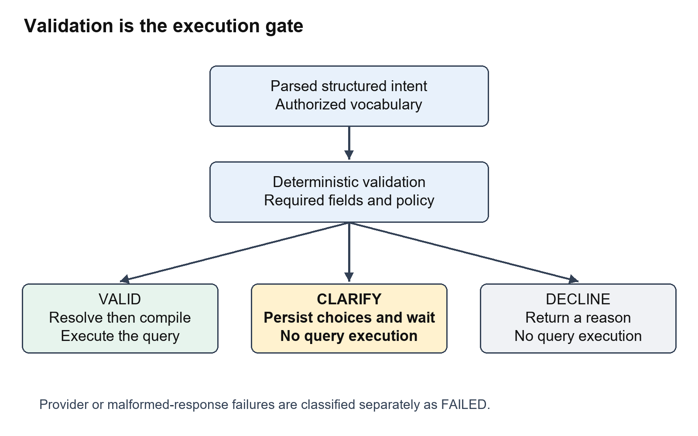
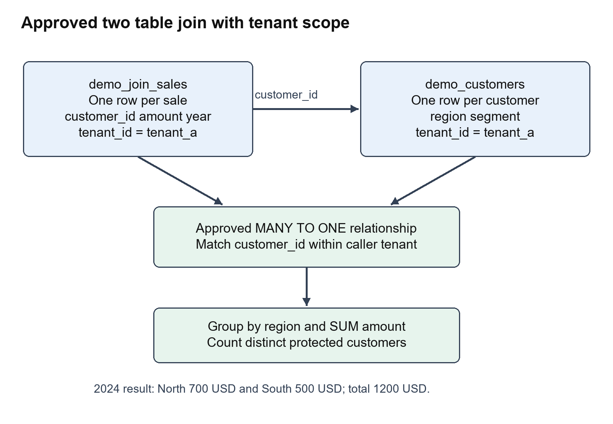
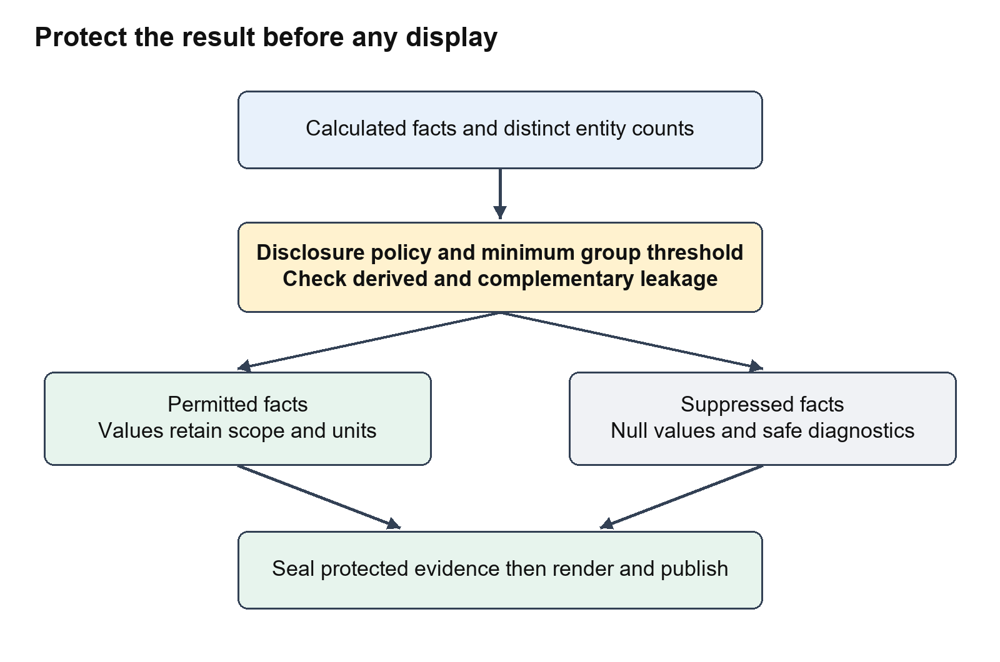
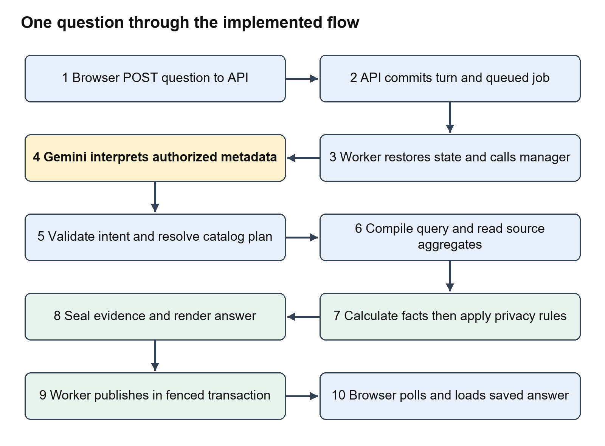
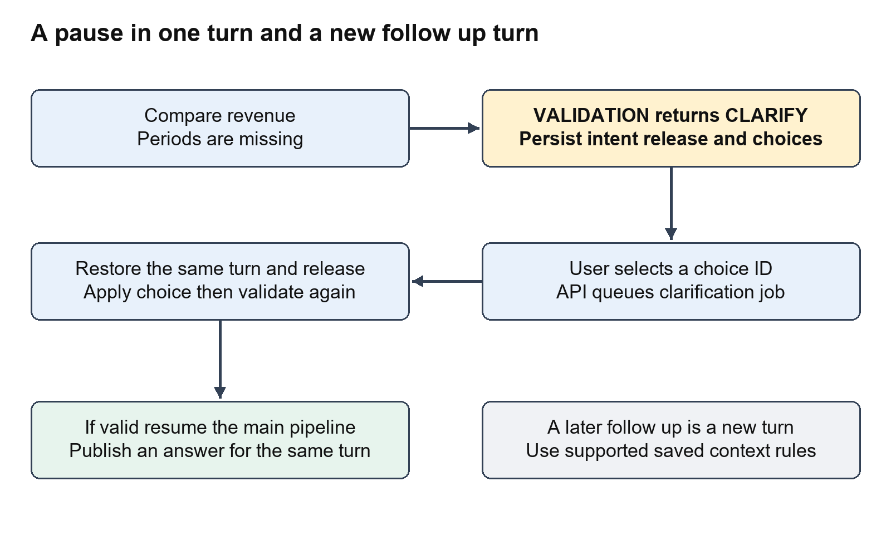
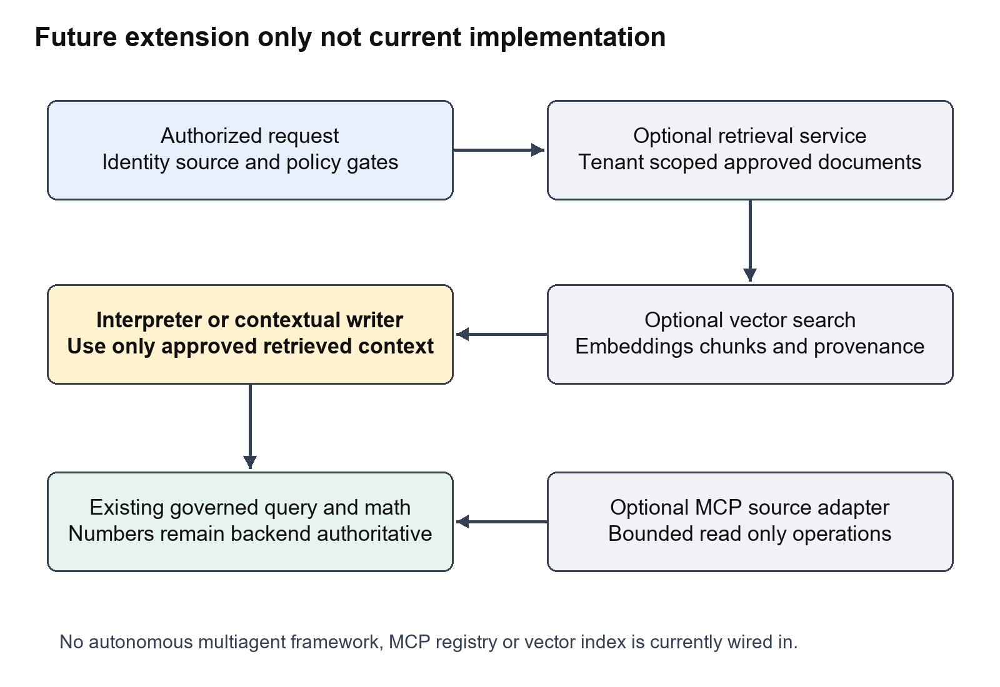
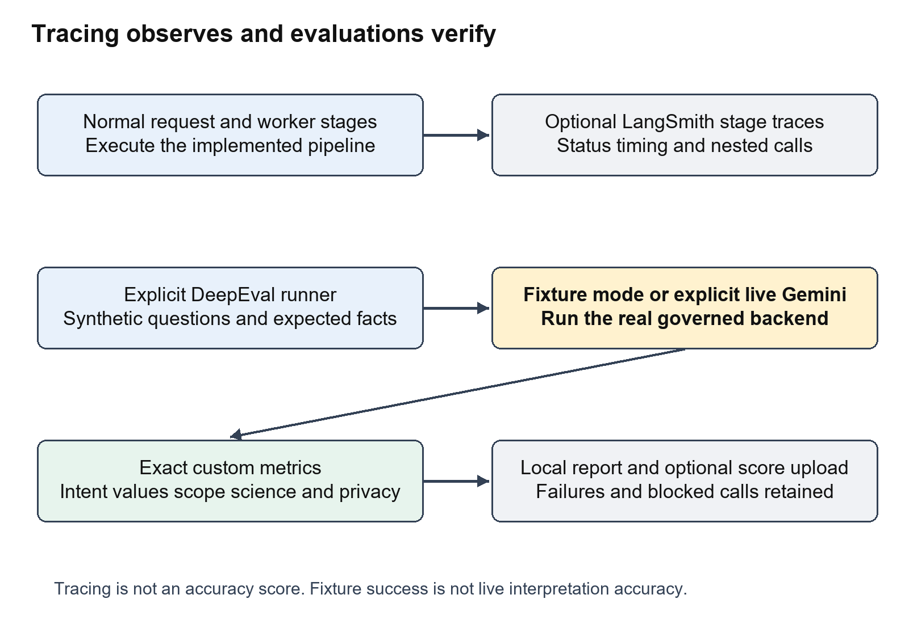

# Talk2Data Complete Project Guide

## Purpose of this guide

This guide explains the current ChatToData project in simple language, following the same order as a person using the app. It starts at the browser, follows a question through the API and worker, explains how the database is queried, and ends with the published answer, chart and export. Each step identifies the component, its input, the work it performs, its output and the next component.

Prepared for the project owner on 9 October 2026. The implementation reviewed is in D:\AI-Projects\ChatToData. The product calls itself Talk2Data in the browser and Python package. ChatToData is the workspace name; these names refer to this same project.

The current app is a governed analytics pipeline with one language-model interpretation boundary. Gemini converts a question into structured intent. Approved Python code decides whether the intent is allowed, builds SQL, runs the query, calculates results, protects small groups and renders the answer. The app does not currently run autonomous cooperating AI agents, an MCP client, a vector database or document RAG. Chapter 16 explains these concepts and shows where they could fit in a future extension, separately from the implemented flow.

### How to read this document

Read chapters 1 through 13 in order for the main answer journey. Chapters 14 and 15 explain branches such as clarification, exports, cancellation and errors. Chapter 16 maps the roles people sometimes call agents and explains MCP, RAG and vector databases. Chapters 17 through 20 cover tracing, evaluations, persistence, project phases, startup and code navigation. The glossary at the end explains the technical words used throughout.

The running example is: “Show revenue by customer region in 2024.” Select demo_join_sales for this example. It requires a real join between synthetic sales and customer tables. North should return 700 USD and South 500 USD, giving an overall total of 1,200 USD. Later examples add a Business-customer filter, compare years and calculate contribution to growth.

### What the diagrams mean

Solid arrows show implemented calls or data movement. Boxes labelled Gemini identify a model call. All other main-flow boxes are ordinary application components, not independent AI agents. Diagrams marked Future extension are explanatory proposals and are not features currently running in the app.

## Contents

1. The whole system at a glance
2. What the user sees in the browser
3. What is loaded before the first question
4. Step one submitting a question
5. Step two claiming and restoring a job
6. Step three interpreting the question with Gemini
7. Step four validating the intent
8. Step five resolving the business meaning
9. Step six compiling and executing the query
10. Step seven calculating analytical facts
11. Step eight applying privacy rules
12. Step nine sealing evidence and composing an answer
13. Step ten publishing and showing the answer
14. Clarification and conversation follow ups
15. Exports cancellation errors and recovery
16. Agents MCP tools vector databases RAG and multiagent systems
17. LangSmith and DeepEval through the same flow
18. Storage security and configuration
19. Project phases and remaining boundaries
20. Running the project and reading the code
21. Glossary

## 1 The whole system at a glance



There are two main Python processes in the normal local setup. The FastAPI process serves the browser, authenticates requests, stores questions and returns status or answers. The worker process reads jobs from the application database and executes the analytical pipeline. They share the same application database and runtime configuration. This separation lets a question continue while the browser waits or reloads.

There are also two different database responsibilities. The source database contains business data such as sales and customers. It is opened read-only by the runtime. The application database stores conversations, turns, jobs, published answers, analytical context and audit records. Its tables are operational state, not the source of business revenue.

The semantic catalog sits between the question and the source database. It defines approved measures, their units and aggregation, dimensions, allowed joins, disclosure thresholds and science models. A question cannot create a new business metric merely by naming it. For example, “revenue” must resolve to a catalog definition that identifies its table, amount column and SUM aggregation.

Gemini is an external interpretation service. The app sends the authorized metadata vocabulary and the question to Gemini using the Google SDK. Gemini returns a JSON intent. It does not receive query-result rows through this interpretation boundary, does not run SQL and does not calculate the authoritative revenue figures.

LangSmith receives optional stage traces. DeepEval is an evaluation harness that the developer runs separately. Neither service supplies the business answer. The browser displays the answer that the worker has protected and transactionally published.

### The main handoffs

| Handoff | What moves across the boundary | What does not happen here |
| --- | --- | --- |
| Browser to API | Selected source and question text | The browser does not generate SQL |
| API to job store | Durable turn and job with caller identity | Acceptance is not an analytical answer |
| Worker to Gemini | Question and authorized catalog vocabulary | Source rows are not used as the prompt context |
| Gemini to validator | Structured intent JSON | Model output is not automatically trusted |
| Resolver to compiler | Approved semantic plan | No free-form SQL from Gemini is executed |
| Gateway to analysis kernel | Scoped aggregated query results | No second model call is needed for exact math |
| Disclosure to presentation | Protected evidence facts | Suppressed values must remain hidden |
| Publication to browser | Saved summary, cards, table and charts | The browser does not recalculate the facts |

Code anchors: talk2data/api/app.py create_app; talk2data/jobs/daemon.py run_daemon; talk2data/runtime.py load_runtime; talk2data/lifecycle/session.py ConversationLifecycleManager.

## 2 What the user sees in the browser

The frontend is one HTML file containing its styles and JavaScript: talk2data/api/static/index.html. It is not a React application. FastAPI serves this file at the root URL. The visible interface has a header, a conversation sidebar, a main area of question cards and a bottom question input with a source selector and Submit Question button.



### Opening the app

The window.onload handler requests GET /api/v1/sources. The server returns only sources allowed for the caller's tenant. JavaScript creates the source-select control from that response. If no sources are available, submission is disabled. The handler also calls loadConversations, which requests GET /api/v1/conversations and fills the sidebar.

The demo normally exposes demo_sales and demo_join_sales. demo_sales is the original one-table synthetic source used for totals, forecasts, anomalies and fixed-volume science examples. demo_join_sales is a separate semantic source for the sales/customer join examples. Selecting it chooses a catalog source; it does not give the browser direct access to the database file.

### Starting or reopening a conversation

The New Conversation button calls createNewConversation. That sends POST /api/v1/conversations with a title and stores the returned conversation ID in browser state. Selecting a sidebar item updates that ID and calls loadConversationDetails. The details endpoint returns the persisted turns, and renderTurns rebuilds their visible cards.

If a user submits a question without first creating a conversation, submitQuestion creates one automatically. A conversation holds many turns. A turn represents one analytical request, not the entire chat. The source is chosen for each submitted question; it is not a single immutable browser-wide database connection.

### Understanding the question cards

A card shows the original question, a status badge and either a processing message, clarification choices, a decline/error reason or a published answer. ANSWERED cards load their answer from a separate endpoint. Clarification cards show buttons generated from the server's discrete choices. In-progress cards can display Cancel.

The header shows local demo identity, tenant_a and user_alice. This is a development convenience, not a production sign-in screen. The current JavaScript does not implement an account login flow or attach a production bearer token to every request and download. Deployment implications are explained in chapter 18.

### UI functions in the order they become relevant

| User action | Browser function | Server endpoint |
| --- | --- | --- |
| Open the page | window.onload and loadConversations | GET sources and GET conversations |
| Start a chat | createNewConversation | POST conversations |
| Open chat history | loadConversationDetails and renderTurns | GET conversations/{id} |
| Submit question | submitQuestion | POST conversations/{id}/questions |
| Wait for execution | pollTurn | GET turns/{id} |
| Choose clarification | submitChoice | POST turns/{id}/clarification |
| Load the completed result | loadAnswer | GET turns/{id}/answer |
| Cancel | Cancel button handler | POST turns/{id}/cancel |
| Download | Export links | GET turns/{id}/export/csv or xlsx |

Code anchors: index.html createNewConversation, loadConversations, loadConversationDetails, renderTurns, pollTurn, submitQuestion and window.onload.

## 3 What is loaded before the first question

The API and worker need the same view of the data. load_runtime reads TALK2DATA_RUNTIME_CONFIG, resolves the source_database path relative to the runtime JSON file, creates the security runtime, registers the semantic catalogs and opens a read-only SQLite source connection. It returns the security runtime, catalog store and source gateway.

The API's create_app puts these objects into app.state and attaches the application store, worker, export service and follow-up service. The standalone daemon constructs the same lifecycle manager from the same runtime configuration. The normal server uses the daemon to process queued jobs. A supplied manager in tests can enable an embedded background worker; that test arrangement is separate from the normal two-process setup.

### The business catalog in plain language

| Catalog object | Question it answers | Join-demo example |
| --- | --- | --- |
| Source | Which approved data domain is this question about | demo_join_sales |
| Release and epoch | Which version of the definitions is being used | join_demo_v1 and epoch 1 |
| Table | Where is data and what does one row represent | A sale or a customer |
| Measure | What numeric quantity can be requested | revenue uses SUM(amount) in USD |
| Dimension | How can a result be grouped or filtered | Customer region and segment |
| Join edge | Which relationship may combine tables | Sales customer_id to customers customer_id |
| Default period | Which dimension represents time | year |
| Disclosure setting | Which populations can be shown | At least five distinct customers per group |
| Time series policy | Which science calculations are eligible | Frequency, minimum history and maximum horizon |
| Scenario model | Which hypothetical formula is approved | price multiplied by fixed quantity |

The catalog is declarative: business definitions are data structures rather than instructions invented by the model. It also contains allowlists for families and dimensions. An approved measure may permit TOTAL and COMPARISON but not FORECAST. The validator and resolver enforce those restrictions later.

The catalog store keeps releases in memory for the process. Pinning a release means selecting an immutable set of semantic definitions for a turn. It is not a physical historical snapshot of every source row. Changes to source data can still affect a later query unless the source itself supplies snapshot/version behavior.

The original demo initializer creates revenue history with 100, 120, 140, 160 and 180 USD for years 2020 through 2024. The join-demo initializer adds another source and tables without replacing that original catalog. Its customer records include another tenant with matching customer IDs and very large sales amounts; the tenant-scoping tests ensure those amounts never inflate tenant_a results.

Code anchors: runtime.py load_runtime; catalog/schema.py catalog definitions; catalog/store.py register_catalog and pin; demo.py initialize; join_demo.py add_join_demo.

## 4 Step one submitting a question

The user selects demo_join_sales, types “Show revenue by customer region in 2024” and submits. submitQuestion trims the input, creates a conversation if needed, clears the input and sends a JSON request containing source_id and question.

```json
{
  "source_id": "demo_join_sales",
  "question": "Show revenue by customer region in 2024."
}
```

### What the API does next

1. get_current_actor derives the caller's tenant, subject, roles and permissions. Development uses convenience identity; production requires a valid signed bearer token.
2. The route verifies that the caller owns the conversation. A user cannot submit into another person's conversation simply by changing its ID.
3. The route checks source access. The selected source must be granted to the caller's tenant.
4. The store atomically inserts the question's turn and the processing job. Atomic means both changes succeed together or neither is committed.
5. The API returns HTTP 202 Accepted with job_id, turn_id and current status. The browser begins reading history and polling status.

An idempotency key identifies one submission so a retry with the same key does not create a duplicate job. The API accepts an Idempotency-Key header and detects conflicting reuse. The current browser submit handler does not supply a stable key; the route generates one when absent. Therefore the API supports idempotent retries, but repeated independent browser clicks should not be described as universally deduplicated.

Development API requests can include proposed_llm_json for controlled verification. In that mode the lifecycle manager receives supplied structured intent and bypasses Gemini. The normal browser submit handler sends only the source and question. Browser fixture tests inserted the extra field explicitly, and their screenshots were labelled. Production rejects proposed intent input.

### What exists after acceptance

There is a persisted conversation, a SUBMITTED turn and a queued job. There is no published analytical answer yet. A 202 response means the request was accepted for work; it does not prove that the question is supported or that the model/provider will succeed.

Code anchors: api/routes.py SubmitQuestionRequest and submit_question; api/auth.py get_current_actor; storage/repository.py submit_question_atomic and submit_job_idempotent.

## 5 Step two claiming and restoring a job

The daemon repeatedly calls DurableJobWorker.process_next_job. An idle poll returns without creating a LangSmith trace. When a job is available, the store claims it for a particular worker and gives that attempt a fencing token.



A lease is a temporary right to process the job. A heartbeat renews it while the worker is active. A fencing token identifies the specific attempt that currently owns that right. If an old attempt finishes after its lease was lost or after cancellation, it cannot publish using its stale token.

The worker reconstructs the ApiActor from the stored identity and checks current source access again. It restores conversation turns and any persisted execution state into the lifecycle manager. That execution state includes the pending intent and pinned semantic information needed for retries or clarification. Restoration matters because the worker's memory is not the durable record.

For SUBMIT_QUESTION, the worker calls manager.submit_turn. For SUBMIT_CLARIFICATION, it restores the waiting turn and calls manager.submit_clarification_choice. It does not ask a team of agents to decide what to do. The operation field chooses a known method in ordinary Python control flow.

One manager and source connection execute one job at a time under an execution lock. Multiple worker processes can compete for jobs through the shared database. That is worker concurrency with ownership controls, not multi-agent reasoning. SQLite and the present process arrangement remain important scale limits.

The worker later writes state, context, audit events and answer publication under transaction and fencing checks. An in-memory ANSWERED result from the manager is held at COMPOSING in storage until the answer is safely inserted. The browser should see ANSWERED only with the published result available.

Code anchors: jobs/daemon.py run_daemon; jobs/worker.py process_next_job and _process_claimed_job; storage/repository.py claim_next_job, renew_lease, assert_job_ownership, restore_execution_state and transaction.

## 6 Step three interpreting the question with Gemini

submit_turn first verifies access and conversation ownership. It creates or restores the turn, records a question-submitted audit event and checks obvious cross-tenant injection attempts and greetings. Those fast-path rejections happen before the model. The injection patterns are a limited early screen; database isolation and authorization are the stronger downstream controls.

Next, the manager pins a semantic release and builds AccessibleVocabulary for the caller. The vocabulary exposes authorized measures and dimensions, plus approved scenario and time-series metadata. This is controlled metadata grounding. It is a direct catalog projection, not vector similarity search.

### The model boundary

GeminiIntentAssist builds a prompt containing the vocabulary and user question. The measure metadata now includes aggregation, allowed families and dimensions. The system instructions require a structured JSON object, prohibit invented SQL and insist on approved measures. The call uses the google-genai SDK, a constrained JSON response schema and temperature zero.

For the running example, the intended result is:

```json
{
  "measure": "revenue",
  "family": "TOTAL",
  "dimensions": ["region"],
  "filters": [],
  "current_period": "2024",
  "comparison_period": null,
  "ambiguity_code": null,
  "assumptions": []
}
```

This JSON says what the user means, not how to implement the query. It contains no SQL, database credentials or final revenue values. The compiler later decides which tables and conditions are required.

### Who calls which tool at this point

ConversationLifecycleManager calls GeminiIntentAssist.interpret. That method calls client.models.generate_content in the Google SDK. This is the live LLM call in the normal app flow. It is not an MCP tool invocation. There is no autonomous agent loop selecting arbitrary tools, browsing files or issuing model-authored database commands.

The adapter has bounded retries for certain unavailable responses and returns a provider_failure marker when it cannot obtain an answer. The parser classifies provider failure and malformed output. These can produce FAILED instead of an unsupported-question decline. Temperature zero and a JSON schema reduce variability but do not guarantee correct interpretation; live evals found and helped fix unrequested grouping and an incorrect average family.

Code anchors: lifecycle/session.py submit_turn; catalog/store.py get_accessible_vocabulary; intent/gemini_assist.py build_catalog_prompt and interpret; intent/parser.py parse_with_bounded_retry.

## 7 Step four validating the intent

The app parses the model response into StructuredIntent. The manager then resolves permitted conversational context and relative dates before running IntentValidator.validate_intent. This gate checks meaning against the approved vocabulary and family requirements.



The validator can produce exactly three logical outcomes: VALID, CLARIFY or DECLINE. VALID supplies a validated intent for execution. CLARIFY creates a bound request with a prompt and discrete choices, then the turn stops at AWAITING_CLARIFICATION. DECLINE gives a reason and ends the analytical path. A provider problem is handled separately as FAILED.

### Checks in this gate

The validator prevents direct tenant-isolation filters, rejects unknown or unauthorized measures, checks permitted families and dimensions, checks filter vocabulary and requires information needed by science families. An average operation must use an approved average metric downstream. Comparison needs both periods. Forecast needs an eligible policy and a horizon. Scenario and goal seek must identify a usable approved model and appropriate parameters.

Missing information is not always an invalid request. “Compare revenue” identifies the metric and operation but not the periods, so the app presents choices and waits. By contrast, a supplied intent naming unicorn_profit fails because that metric does not exist in the catalog. A natural-language unknown-metric question can be interpreted differently by a model; the verified unknown-metric evaluation was fixture-only.

The turn and clarification request are associated with tenant, subject, source and release. A choice is an identifier for one server-defined resolution, not arbitrary instructions to execute. This makes resumption controlled and explainable.

### Current clarification limitation

Some comparison/year option lists in validator.py are explicitly coded around sample periods such as 2024 and 2023. The implementation should not be described as a universal, data-driven period picker. A broader deployment would need catalog/source-aware period discovery and UX work. The document follows the present behavior rather than assuming that design requirement is already fully delivered.

Code anchors: intent/schema.py StructuredIntent and AnalysisFamily; intent/validator.py validate_intent; domain/models.py ClarificationRequest; lifecycle/session.py context resolution and validation branches.

## 8 Step five resolving the business meaning

When validation succeeds, _execute_validated_turn transitions to ANALYZING, records the analysis-start event and checks current source access again. SemanticResolver.resolve turns the intent into a ResolvedSemanticPlan using the pinned catalog.

The resolver identifies the measure's base table and grain, requested dimensions, filter dimensions, period table and column, approved join edges, grouping columns, aggregation and science settings. Grain means what one record represents. A sale measure cannot safely be repeated across multiple child rows without knowing how to allocate it.

### The running example becomes a plan

| Plan field | Resolved meaning |
| --- | --- |
| Tenant | tenant_a from trusted actor context |
| Measure | revenue defined as SUM of sale amount in USD |
| Base table | demo_join_sales at sale grain |
| Dimension | region from demo_customers |
| Period | year 2024 on the sales table |
| Required tables | demo_join_sales and demo_customers |
| Approved relationship | Sales customer_id to customers customer_id |
| Cardinality | Many sales can belong to one customer |
| Privacy population | Distinct sales customer_id, minimum five |

The resolver follows declared relationships. It does not infer a join from similarly named columns or let Gemini invent one. Current relationship resolution mainly finds direct approved edges from the base table to requested dimension/filter/period tables; it should not be described as a general multi-hop graph planner.

Filter-only joins also matter. Asking “average sale value for North customers” has no region grouping, but its North filter still needs the customer table. The resolver includes that table and approved edge so the compiler can apply the filter correctly.

### Why cardinality is checked

Joining one order to three line items can repeat the order amount three times. If no explicit allocation policy exists, the app rejects the unsupported parent/child aggregation. The implemented equal-split policy is a specific catalog-authorized behavior, not an assumption that every relationship should divide amounts. Arbitrary many-to-many joins and complex allocation graphs are not established by this demo.

The manager rechecks measure and dimension access, including dimensions used in filters. It applies dataset disclosure policy and disables datasets that require cross-query privacy protection unavailable in the present implementation.

Code anchors: semantic/resolver.py resolve; semantic/plan.py ResolvedSemanticPlan; catalog/schema.py ApprovedJoinEdge and MeasureDefinition; lifecycle/session.py _execute_validated_turn.

## 9 Step six compiling and executing the query

GovernedQueryCompiler.compile receives the semantic plan, not the user's raw question. It validates table/column identifiers, selects approved expressions, binds parameter values, adds tenant scope and returns a PhysicalQueryPackage. GenericSourceGateway.execute_package executes that package on the read-only SQLite connection.



### Representative query for the running example

The following is an explanatory rendering of the governed query shape. The compiler constructs its actual SQL and parameter names at runtime.

```sql
SELECT demo_customers.region,
       SUM(demo_join_sales.amount) AS metric_value,
       COUNT(DISTINCT demo_join_sales.customer_id)
           AS protected_entity_count
FROM demo_join_sales
INNER JOIN demo_customers
  ON demo_join_sales.customer_id = demo_customers.customer_id
 AND demo_customers.tenant_id = :tenant_id
WHERE demo_join_sales.tenant_id = :tenant_id
  AND demo_join_sales.year = :period
GROUP BY demo_customers.region
```

The caller's tenant is bound by the application. Both the sales table and joined customer table are tenant-scoped. Customer IDs overlap across demo tenants, so filtering the base table alone would be insufficient if joined customer rows were unrestricted.

For “Business customers,” the plan adds a filter dimension segment. The compiler maps that dimension to demo_customers.segment and binds the Business value in a parameter. Values are not pasted into SQL as instructions. Tenant filters cannot be overridden by user filters.

### SQL and Python have different jobs

SQL filters populations, joins approved tables, groups records and aggregates measures. The gateway registers Decimal-based SUM, AVG and division helpers for the SQLite implementation, so monetary calculations do not rely on ordinary binary floating-point accumulation. Python then calculates comparison deltas, growth, contribution and governed science outputs from the returned aggregates.

The gateway enforces SELECT-only execution, query_only mode and a progress-handler timeout. It returns aggregate records such as region, metric_value and protected_entity_count. Current execution is SQLite-specific despite the GenericSourceGateway class name; no general warehouse connector collection or MCP database service is wired in.

Code anchors: compiler/compiler.py compile and identifier/read-only checks; compiler/ast.py PhysicalQueryPackage; execution/gateway.py execute_package and Decimal aggregate registration.

## 10 Step seven calculating analytical facts

DeterministicAnalysisKernel.analyze converts query results into ProtectedFact objects. A fact records the metric, calculation type, Decimal value, unit, period, dimensions, release, lineage, completeness, assumptions and limitations. It can also record science diagnostics and whether a result is observed, predicted, hypothetical or a solver solution.

### Operations in the current kernel

| Family | What SQL supplies | What Python calculates | Important meaning |
| --- | --- | --- | --- |
| TOTAL | Approved grouped or overall aggregate | Facts and applicable additive totals | A defined metric, not invented revenue |
| AVERAGE | Approved AVG aggregate | Average fact and presentation metadata | It must use an approved average measure |
| TREND | Period aggregates | Ordered observations and facts | Historical series, not a forecast |
| COMPARISON | Current and prior populations | Delta and percentage growth | Missing observations are not automatically zero |
| CONTRIBUTION | Category values for periods | Shares or contribution to growth | Additive metrics and scope matter |
| FORECAST | Approved chronological history | Linear trend projection and intervals | Model-dependent prediction |
| ANOMALY | Approved historical series | Median and MAD deviation scores | Statistical deviation, not proof of fraud |
| SCENARIO | Approved driver values/defaults | Formula under requested adjustments | Hypothetical output |
| GOAL_SEEK | Approved model/defaults and bounds | Driver value required to approach target | Solver result under fixed assumptions |

### The join calculations step by step

For tenant_a, ten North customers each have a 2024 sale of 70 USD and ten South customers each have a 2024 sale of 50 USD. SQL returns North 700 and South 500. The kernel emits scoped category facts and the additive overall total 1,200. The other tenant's large amounts are excluded.

For Business customers, there are five eligible customers in each region. North becomes 5 × 70 = 350 and South becomes 5 × 50 = 250, total 600. These groups meet the minimum five-customer threshold. Narrower groups could be suppressed.

For comparison, the manager compiles and executes the current plan and a second plan for the comparison period. In 2023, North is 500 and South is 400. North's delta is 700 − 500 = 200 and growth is 200 ÷ 500 × 100 = 40%. South's delta is 100 and growth is 25%. Facts are matched by category, not by crossing year labels as categories.

For growth contribution, total growth is 1,200 − 900 = 300. North contributes 200 ÷ 300 × 100 = 66.67%; South contributes 33.33%. This differs from current-period revenue share: North's 2024 revenue share is 700 ÷ 1,200, not 66.67%. The app distinguishes these calculations.

### Science examples on the original demo

The annual series 100, 120, 140, 160, 180 has a steady +20 slope. The approved forecast produces 200 for 2025 and 220 for 2026. Forecast policy checks frequency, chronology, gaps, minimum history and horizon. Prediction intervals are estimates, not guaranteed coverage.

MAD anomaly detection on this series finds no anomalies under its declared threshold. Scenario price 30 with quantity fixed at 5 yields 150. Goal seek for output 150 finds price about 30.00068359375, producing 150.00341796875 with residual within 0.01. Nonlinear goal seek does not prove every possible root or global infeasibility by finite sampling.

Code anchors: execution/kernel.py analyze, compute_comparison and compute_growth_contribution; science/forecast.py, anomaly.py, scenario.py, goal_seek.py and formulas.py.

## 11 Step eight applying privacy rules

Correct numbers are not automatically releasable numbers. After analysis, the manager computes population counts and calls GovernedDisclosureService.inspect_and_protect. The service applies minimum-group suppression and complementary protection, including derived outputs that could reveal hidden inputs.

The compiler counts distinct protected entities in the governed query. For the join demo the entity is customer_id and the minimum is five. A ten-customer region can be shown; a five-customer Business segment can be shown. The separate protected_revenue browser/eval fixture uses a minimum of six while the original demo period has only five customers, so its value is suppressed.



### What suppression changes

The protected fact has value null and is_suppressed true. Sensitive assumptions, diagnostic values and prediction intervals are removed or replaced with safe suppression messages. The UI displays a suppression marker rather than a number. Dependent calculations must not reveal a suppressed input through another channel.

Complementary suppression addresses subtraction attacks within a release. If one category is hidden but the total and every other category are shown, the hidden number could be calculated by subtraction. The service can hide an additional category or total to reduce that direct deduction path.

This is basic disclosure control, not a differential privacy guarantee. The repository contains an experimental repeated-query accounting helper, but datasets that require cross-query privacy protection are disabled in the execution path. It is incorrect to say the app already provides complete protection against every sequence of related queries.

Permission checks and privacy thresholds answer different questions. Authorization decides whether this caller may request the source, metric and dimensions. Disclosure decides whether the resulting population can be shown. Passing authorization does not bypass suppression.

Code anchors: lifecycle/session.py _population_counts and disclosure-policy handling; security/disclosure.py GovernedDisclosureService and suppression helper; compiler/compiler.py protected_entity_count.

## 12 Step nine sealing evidence and composing an answer

The manager seals the protected facts in a SealedEvidencePackage. The package includes its turn, tenant, semantic release and a canonical SHA-256 digest. verify_integrity can recompute the digest and check that the fact representation has not changed.

This evidence fingerprint is different from the signed audit chain. A hash detects changes relative to a known digest; it is not hardware tamper resistance or independent non-repudiation. The audit chain is explained in chapter 18.

The manager records evidence_sealed, clears the gateway's transient buffer and records a buffer-disposal digest. close_without_values performs application-level clearing and garbage collection. It does not securely zero every copy in physical memory, and local variables can remain until normal object lifetime ends. The cleanup event should not be interpreted as cryptographic RAM erasure.

### How the visible answer is written

DeterministicPresentationFallback.render takes sealed evidence and produces RenderedAnswerView: summary text, KPI cards, table columns/rows, assumptions, limitations, suppression state and evidence digest. It uses templates and the facts; there is no separate answer-writing model in the current main flow.

For the running question, the view includes a total of 1,200 USD and region rows North 700 and South 500. For a category comparison, it includes values for both periods, change and growth. Non-additive group values are not blindly summed into a misleading overall average.

ChartGenerator creates chart specifications from the protected facts. The worker stores those specifications with the published answer. The browser later renders them. Forecast and scenario labels identify predicted or hypothetical values; users should not read those values as observed database facts.

The manager transitions through COMPOSING to an in-memory ANSWERED result and returns it to the worker. Durable publication is still required before the UI can treat that answer as available. The distinction between in-memory calculation and persisted publication is essential to recovery and cancellation behavior.

Code anchors: domain/facts.py ProtectedFact, SealedEvidencePackage.seal and verify_integrity; execution/gateway.py close_without_values; presentation/fallback.py render; presentation/charts.py generate_charts.

## 13 Step ten publishing and showing the answer

The worker now enters the publication transaction. It verifies current lease ownership, saves the turn/execution state and audit events, rechecks answer permissions, creates chart specifications and calls publish_answer_transactional. It saves analytical context and completes the job in the same protected processing path.

Publication checks that the job has not been cancelled and that the worker and fencing token still own it. It also checks the turn state and existing answer version. Recovery must not overwrite a newer or identical publication. Question answers use version 1; the clarification operation uses version 2 in the worker's current path. These version numbers are application behavior, not an arbitrary collaborative editing system.



### The browser receives the result

pollTurn requests status about once a second. It stops for ANSWERED, DECLINED, FAILED or CANCELLED. It also stops at a clarification wait only when a clarification job is no longer queued/running. This distinction prevents the UI from showing stale choices while a submitted choice is still being processed.

After the status changes, the browser reloads conversation details. renderTurns sees ANSWERED and calls loadAnswer, which requests GET /api/v1/turns/{id}/answer. The repository checks ownership and current source/metric/dimension permissions again before returning the saved view. Revoking access should affect retrieval as well as new execution.

loadAnswer fills the card with summary, KPI cards, table, charts, assumptions, limitations and export links. escapeHtml is applied to displayed strings. The current chart UI renders simple bar/line-style specifications and labels using page markup rather than a full interactive charting-library workspace.

### What the user can conclude

ANSWERED means a governed result was produced and published. It does not mean every requested value is visible: an answered result can be suppressed. A forecast answer has assumptions and model limits. The user should read the operation label, period, units, suppression markers and limitations along with the number.

Code anchors: jobs/worker.py _process_claimed_job publication block; storage/repository.py publish_answer_transactional and get_published_answer; index.html pollTurn, renderTurns and loadAnswer.

## 14 Clarification and conversation follow ups

### Clarification is a pause inside one turn

When the user asks “Compare revenue,” the metric is known but the periods are missing. Validation stops before resolution, compilation and database execution. The worker persists the pending intent, pinned release and clarification request. The browser shows the period-choice buttons.



Selecting a button calls submitChoice and sends choice_id to the clarification endpoint. The API verifies ownership and the waiting status, then queues SUBMIT_CLARIFICATION. The worker restores state, resolves the valid server choice and updates the pending intent. It re-runs validation against the original pinned release. Only when that passes does it resume the main execution path.

A clarification does not require another Gemini call merely to translate a known choice. Choice application is deterministic. If information remains missing, the same gate can ask another clarification. A process restart does not have to lose the request because the state is stored in the application database.

### A follow up is a new turn

A follow-up question is different. It is submitted through the normal question route and creates a new turn. The lifecycle manager can resolve some omitted metric/period context from earlier authoritative intent and normalize relative time expressions. Its context restoration and calendar handling are code-based rules, not unlimited semantic memory.

After publication, the worker saves analytical context such as source, metric, dimensions, periods and scope. This is structured context, not a vector embedding of the whole chat. Source consistency and supported patterns matter; the system should not be described as understanding every possible elliptical follow-up sentence.

### Suggested next questions

FollowUpService can return up to three suggestions based on persisted context and accessible catalog metadata. Examples include another breakdown, a prior-year comparison or an overall total. The endpoint exists at GET /api/v1/conversations/{id}/follow-ups. The current index.html does not request or display these suggestions, so this is an implemented backend capability with a remaining UI integration gap.

Calendar enrichment reports time zone/fiscal alignment and explicitly avoids causal claims. Overlap with a business calendar does not prove why revenue changed. There is no document retrieval agent supplying causal explanations in the current app.

Code anchors: lifecycle/session.py submit_clarification_choice, _apply_choice_to_intent and _resolve_conversational_and_temporal_context; context/followup.py FollowUpService; storage/repository.py save_analytical_context and restore_execution_state; execution/calendar.py.

## 15 Exports cancellation errors and recovery

### Export flow

The user clicks Export XLSX or Export CSV on an answered card. The browser follows an export endpoint for that turn. SecureExportService reads the published answer through authorization checks and produces the permitted table dataset. It does not run a new analytical SQL query or ask Gemini to reconstruct the numbers.

Spreadsheet formula injection is addressed by sanitizing risky leading characters in exported cell text. Export should preserve the protected/suppressed view. Production download authentication needs the same integration work as the rest of the current browser because the demo links do not supply a complete login/token flow.

### Cancellation flow

The Cancel button sends POST /api/v1/turns/{id}/cancel. The store marks the job/turn cancelled and invalidates publication ownership. If a model request or query is already running, cancellation does not necessarily physically interrupt that external/in-progress operation immediately. The crucial guarantee is that a stale or cancelled attempt cannot publish a successful answer after losing authority.

### Interpreting errors

| Result | Meaning | User action |
| --- | --- | --- |
| AWAITING_CLARIFICATION | Required meaning is missing | Choose a valid option |
| DECLINED | Unsupported or unauthorized analysis/policy condition | Read reason and change the request or grants |
| FAILED | Provider, parse or execution problem | Check diagnostics, configuration and availability |
| CANCELLED | Work was cancelled | Submit a new request if still needed |
| ANSWERED with suppression | Calculation completed but disclosure limits hide values | Respect the population restriction |

The manager checks provider failures and malformed JSON before semantic execution. Gemini timeout/unavailability/quota is not evidence that the metric is unsupported. Query and science failures have separate analytical consequences. The worker's job-failure logic should be read with the manager's error strings; retry classification currently includes string-based checks, so the code is not a fully typed provider-error taxonomy.

### Recovery after a process stops

Jobs and turns live in SQLite, so a daemon can reclaim work after an expired lease. The new attempt has a new fencing token. Pending intent, clarification and release scope can be restored. Publication transactions and answer version checks protect against late or duplicate writes. This supports tested local recovery; it is not evidence of unlimited distributed throughput or a managed queue deployment.

Code anchors: export/export.py SecureExportService; api/routes.py export and cancel routes; storage/repository.py cancel_job_and_turn, claim_next_job, fail_job and publication; jobs/worker.py failure/fencing branches.

## 16 Agents MCP tools vector databases RAG and multiagent systems

### The precise implementation status

The word agent can mean a logical responsibility or an autonomous language model that chooses tools and loops over a task. This app has several logical responsibilities implemented as Python classes. Its main runtime does not implement an autonomous multi-agent framework, manager/worker reasoning agents, an MCP tool registry, vector indexing or document RAG.

If an earlier design discussion called these responsibilities agents, the following table maps those names to the code that actually performs the work. The role labels are explanations, not additional independently running services.

| Logical role | Actual component | When it enters | Input and output | External or MCP tool call |
| --- | --- | --- | --- | --- |
| UI assistant role | Browser JavaScript | User opens or interacts with page | User actions to HTTP requests | HTTP fetch only; no MCP |
| Identity and policy role | API auth and SecurityRuntime | Request, execution and retrieval gates | Caller context to permission decision | No LLM or MCP |
| Coordinator role | ConversationLifecycleManager | Worker submits/resumes a turn | Turn to ordered validation/execution path | Calls known Python services |
| Intent interpreter role | GeminiIntentAssist | After access and vocabulary projection | Question plus metadata to JSON intent | Google SDK generate_content; no MCP |
| Validation role | IntentValidator | After parsing/context resolution | Intent to VALID, CLARIFY or DECLINE | No LLM or MCP |
| Semantic planning role | SemanticResolver | Only after VALID | Intent plus pinned catalog to plan | No LLM or MCP |
| SQL compiler role | GovernedQueryCompiler | After semantic resolution | Plan to bound read-only query | No LLM or MCP |
| Data access role | GenericSourceGateway | Query package ready | SQL/parameters to aggregates | SQLite connection; no MCP |
| Analysis role | DeterministicAnalysisKernel and science engines | Aggregates available | Aggregates to analytical facts | Deterministic math; no LLM or MCP |
| Privacy role | GovernedDisclosureService | Before evidence/presentation | Facts/counts to protected facts | No LLM or MCP |
| Answer writer role | DeterministicPresentationFallback | Protected evidence ready | Evidence to summary/cards/table | Templates; no writer model |
| Chart role | ChartGenerator and UI renderer | Publication and display | Protected facts to chart specs/markup | No LLM or MCP |
| Durable execution role | Worker and application store | Queued job and publication | Job/lease to persisted completion | SQLite operations; no MCP |
| Follow up role | FollowUpService | Explicit backend suggestion request | Saved context to suggestions | Catalog rules; no RAG |
| Evaluation role | DeepEval runner and custom metrics | Developer explicitly runs evals | Synthetic cases to exact scores | Optional Gemini in live mode and LangSmith scores |

### MCP in simple language

MCP is a standard way for an AI application to discover and call tools/resources exposed by another service. It could expose an approved data-source operation, metadata lookup or document search. In this project today, database access is a direct Python SQLite operation and Gemini access is a direct SDK call. Neither becomes MCP merely because it talks to a service.

The Codex tools used to build, inspect, test or document this project belong to the development environment. They are not tools automatically available to the running Talk2Data application. Confusing development tools with runtime tools would make the architecture diagram inaccurate.

### RAG and a vector database in simple language

RAG means retrieving relevant context and supplying it to a generation step. A vector database can store embeddings, which are numeric representations used to find similar content. It is one possible retrieval mechanism, not a business-math engine and not a synonym for SQLite.

The implemented catalog projection supplies authorized metadata directly to Gemini. It does not split documents, generate embeddings, search similar chunks, rerank results or assemble cited document passages. No vector store is provisioned in the current runtime. Catalog lookup is grounded and useful, but it should not be presented as a completed vector-RAG stack.

### Where these features could enter a future flow



An optional contextual retrieval service could run after caller/source authorization and before interpretation, or after facts are protected if the user explicitly asks for approved business-document context. It would retrieve only tenant-authorized material with provenance. The LLM could use it to understand business terminology or explain approved context, while authoritative numbers would still come from the governed SQL and math path.

An MCP data adapter could replace a direct source connector behind the gateway boundary. It should expose bounded, read-only operations and preserve catalog allowlists, caller scope, query limits and audit behavior. It should not allow an interpreter to execute arbitrary SQL simply because a database tool exists.

A future multi-agent design could separate interpretation, contextual retrieval and narrative drafting under an explicit coordinator. Independent agent messages would require schemas, limits, provenance and gates. The compiler, authorization, privacy and numerical engines should remain authoritative deterministic components. Parallel agents would not remove the need for leases, publication fencing or disclosure checks.

These are extension locations, not an approved implementation plan or a claim of completed work. The actual current sequence remains the one in chapters 4 through 13.

## 17 LangSmith and DeepEval through the same flow

LangSmith and DeepEval answer different questions. LangSmith shows which stages ran, how long they took and what status they reached. DeepEval checks selected outcomes against known expectations. Tracing a request does not prove its number is correct, and a passing fixture eval does not prove a live model interpreted arbitrary questions correctly.



### LangSmith during real application execution

traced_stage wraps interpretation, turn handling, clarification, governed execution, query compilation/execution, analysis, privacy, presentation, claimed jobs and answer publication. Nested calls appear within the worker's trace where the execution context permits. The instrumentation does not currently promise one distributed browser/API/worker trace with HTTP trace-context propagation; the worker is its own traced root.

When LANGSMITH_TRACING is enabled, the wrapper uses the SDK trace context. It sends stage names, timing through the trace lifecycle and status. It excludes raw questions, prompts, tenant/user IDs, SQL, result rows, facts, answer values and raw exception details. Idle worker polls do not create traces. Tracing failure must not replay the operation or change its result.

Explicit evaluation uploads add synthetic case ID, fixture/live mode, selected model and metric scores. The supplied key is configured in the ignored local environment file and is not reproduced in this document. LangSmith is operational telemetry; the signed application audit trail has a separate purpose and storage.

### DeepEval when a developer runs evaluations

The custom metrics operate on normalized snapshots of synthetic turns. OutcomeMetric checks terminal/waiting status. IntentMetric checks expected interpretation fields, including dimensions and filters. ExactFactsMetric compares complete selected fact sets, scope, values, units, periods, result types and required science diagnostics. GovernanceMetric checks evidence integrity, absence of facts on unexecuted turns and suppression details.

These metrics do not require an LLM judge. Revenue arithmetic and privacy leaks have objective oracles. Optional live mode lets Gemini interpret questions without fixture intent injection, then runs the same deterministic backend and scores its behavior. A provider failure is BLOCKED and stops the run; it is not a passing or unsupported question.

### Verified results and what they establish

The latest recorded regression run passed 165 tests with five opt-in live integration tests skipped. Nineteen synthetic DeepEval fixture cases passed. Across bounded live-mode runs, 18 distinct cases have passing latest results: 16 invoked gemini-3.1-flash-lite and two were security rejections before interpretation. The unknown-metric case remains fixture-only.

Earlier live runs are retained: two incorrect year-breakdown contracts, one provider timeout and an average labelled TOTAL despite a correct numeric value. Prompt/metadata fixes passed targeted retries. This is curated verification across runs, not one clean full live experiment or a general production accuracy score.

Mutation tests deliberately alter values, regions, periods, units, fact counts, finite-number status, science metadata, seals and suppressed diagnostics to verify that evaluators fail. Telemetry tests verify exclusion, exception propagation and no operation replay on outage. DeepEval is a separate developer harness, not an automatic judge on every normal user turn.

Code anchors: observability.py traced_stage; eval/run_deep.py run and publish_scores; eval/cases.py cases; eval/deep_metrics.py metrics; tests/test_deep_metrics.py and tests/test_observability.py. Supporting record: EVALUATION_REPORT.md.

## 18 Storage security and configuration

### What is stored where

| Location | Stored responsibility | Important boundary |
| --- | --- | --- |
| Source SQLite file | Synthetic sales/customer facts and history | Runtime connection is read-only |
| Runtime JSON | Catalogs, source path and tenant-source grants | Definitions, not a vector index |
| Application SQLite file | Conversations, turns, jobs, answers, context and audit state | Writable operational store |
| Python process memory | Catalog objects, active manager state and transient aggregates | Restored durable state is still required |
| Local .env | Provider and service configuration/secrets | Ignored; keys are not published |
| LangSmith | Optional stage status/timing and explicit eval scores | Raw analytical payloads excluded by wrapper |
| eval-results | Local synthetic evaluation JSON | Ignored generated evidence |

The application store persists question_text and published answer values because the browser needs history and results. Audit events use digests rather than copying raw questions. A source comment describing question text as ephemeral must not be taken to mean the application database never stores it. Retention/pruning helpers exist, but an automatic retention scheduler and full production data lifecycle are not established here.

### Audit and evidence

The persistent audit chain uses a configured secret and signatures/digests so integrity checks can detect changes against the expected chain. A stable TALK2DATA_AUDIT_KEY is important across restarts. An independently stored expected head can help detect rollback/tail deletion. This repository does not supply a trusted external checkpoint service, so the chain alone cannot guarantee detection of every valid rollback.

Protected evidence uses canonical SHA-256 fact fingerprints. It records release and lineage. Catalog release pinning, evidence integrity and the signed audit chain are related but distinct mechanisms. None means the underlying live source database was physically frozen in time.

### Authentication and authorization

Development identity is deliberately convenient. Production requires TALK2DATA_AUTH_SECRET and signed HMAC bearer tokens, rejects client identity spoofing and uses verified payload identity. The token helper is a deployment-integration primitive, not a complete identity provider with account lifecycle, expiry/refresh/revocation UI and login screens.

Authorization is rechecked at source submission, interpretation vocabulary projection, execution, publication, answer retrieval and exports. Tenant conditions are also compiled onto source/join tables. The user interface alone is never the security boundary.

### Configuration map

| Variable | Purpose |
| --- | --- |
| TALK2DATA_ENV | Select development or production behavior |
| TALK2DATA_DB_PATH | Application state database path |
| TALK2DATA_RUNTIME_CONFIG | Shared catalog/source/grant JSON |
| TALK2DATA_MODEL or GEMINI_MODEL | Explicit Gemini model selection; canonical variable wins |
| GEMINI_API_KEY | Provider credential for interpretation |
| TALK2DATA_AUTH_SECRET | Production bearer-token verification secret |
| TALK2DATA_AUDIT_KEY | Stable persistent audit signing secret |
| LANGSMITH_TRACING | Enable or disable optional stage tracing |
| LANGSMITH_API_KEY | LangSmith service credential |
| LANGSMITH_PROJECT | Trace/evaluation destination project |
| RUN_LIVE_LLM_TESTS | Opt in to provider-backed integration tests |

Model availability and quota are provider-dependent. The alternate model used for evals was an explicit test override; it did not permanently change the app model. Both API and worker must read consistent configuration, and changing catalog/grants generally requires process restart in the current declarative runtime.

Code anchors: storage/schema.py and repository.py; api/auth.py; security/auth.py; config.py; runtime.py; lifecycle/audit.py; domain/facts.py.

## 19 Project phases and remaining boundaries

The repository's architectural contract describes four phases. The implementation now has meaningful capabilities in each phase, but a passing test suite is not a claim that every production requirement or future platform feature is complete. The older phase audit is a historical baseline; later fix/browser/evaluation reports record subsequent work.

| Phase | Implemented capability | Current boundary to understand |
| --- | --- | --- |
| Phase 1 Reliable Core | Catalog-driven intent, authorization, clarification, resolver, compiler, exact aggregation and facts | SQLite source runtime; some clarification periods are hard-coded; limited direct-edge planning |
| Phase 2 Reliable Delivery | API/UI, durable jobs, publication, tables/charts and exports | Basic browser UX; backend follow-up suggestions not wired into UI; production login/download token integration needed |
| Phase 3 Decision Science | Governed forecast, anomaly, scenario and goal seek paths | Approved families/models only; scientific assumptions and nonlinear solver limits apply |
| Phase 4 Advanced Controls | Fencing, restart recovery, suppression, evidence/audit checks, evals and tracing | No complete cross-query privacy mechanism, external audit checkpoint service or fully managed scale architecture |

### Features that should not be inferred from the design name

The repository does not currently supply a vector database, document ingestion/embedding pipeline, semantic document search, autonomous multi-agent orchestration or runtime MCP tool calling. It also does not supply broad warehouse adapters, automatic causal explanations, differential privacy guarantees or an enterprise identity provider. These are separate engineering projects if later required.

### UI and operational limitations visible in the code

The frontend keeps one active polling interval rather than a per-turn map, so it is a simple interaction model rather than a rich concurrent workspace. Some submit and clarification fetch calls have limited error handling. Sources are shown as IDs rather than fully described business domains. Suggested follow-ups exist on the backend but are not displayed. These observations belong in an architecture guide because they explain current behavior; this documentation task does not silently redesign them.

The query gateway supports SQLite and its timeout mechanism. The source is not a managed multi-warehouse connector system. Runtime catalog release pinning is semantic definition pinning, not source snapshot isolation. Process locks and SQLite transactions protect this local design, but production throughput, observability retention and identity lifecycle need deployment-specific work.

Code anchors: FINAL_ARCHITECTURAL_CONTRACT.md phase definitions; README.md current setup/scope; index.html polling/fetch handlers; PHASE_IMPLEMENTATION_AUDIT.md historical findings; IMPLEMENTATION_FIX_REPORT.md, BROWSER_TEST_REPORT.md and EVALUATION_REPORT.md later records.

## 20 Running the project and reading the code

### Step by step local setup

1. Install the application requirements in the chosen Python environment.
2. Create an isolated demo directory with python -m talk2data.demo --directory demo. Choose a new directory rather than overwriting existing source/config files.
3. Add the optional join source with python -m talk2data.join_demo --directory demo.
4. Configure TALK2DATA_RUNTIME_CONFIG to that runtime.json, TALK2DATA_DB_PATH to the application SQLite path, development mode and the Gemini credential/model. Configure a stable audit key and optional LangSmith variables. Do not put keys in source or exported reports.
5. Start the API with python -m talk2data.api.server --host 127.0.0.1 --port 8000.
6. In another process using the same configuration, start python -m talk2data.jobs.daemon --poll-interval 0.2.
7. Open http://127.0.0.1:8000, select a source, start a conversation and ask a supported question.
8. If a provider is unavailable, read FAILED/diagnostics. Fixture evals can still validate the deterministic backend, but they do not establish live interpretation.

The current browser-demo launcher is a task-specific helper that supplies a shared environment and starts both processes. The package entrypoints above explain the actual architectural roles. The launcher is not a separate agent framework.

### Reading the code in the same order as the UI flow

| No | File or directory | Start with | What you learn |
| --- | --- | --- | --- |
| 1 | api/static/index.html | window.onload then submitQuestion | User actions and server calls |
| 2 | api/app.py and api/auth.py | create_app and get_current_actor | Startup objects and trusted identity |
| 3 | api/routes.py | submit_question then status/answer routes | API acceptance and retrieval |
| 4 | storage/repository.py | submit_question_atomic and claim_next_job | Durable turns/jobs and ownership |
| 5 | jobs/worker.py | _process_claimed_job | Restore, execute and publish sequence |
| 6 | lifecycle/session.py | submit_turn | Main orchestration and validation gate |
| 7 | catalog/store.py and schema.py | pin and get_accessible_vocabulary | Approved business definitions |
| 8 | intent/gemini_assist.py | build_catalog_prompt and interpret | The LLM boundary |
| 9 | intent/parser.py and validator.py | parse and validate methods | Trust boundary and clarification |
| 10 | semantic/resolver.py and plan.py | resolve and plan fields | Approved semantic plan |
| 11 | compiler/compiler.py and ast.py | compile | Governed SQL and bound values |
| 12 | execution/gateway.py and kernel.py | execute_package and analyze | SQLite aggregates and Python math |
| 13 | science | Family-specific engines | Forecast/MAD/formula/solver behavior |
| 14 | security/disclosure.py and domain/facts.py | inspect_and_protect and seal | Privacy and evidence |
| 15 | presentation | render and generate_charts | Fact-based visible answer |
| 16 | storage/repository.py | publish_answer_transactional | Fenced persistent publication |
| 17 | export/export.py and context/followup.py | Export and suggestion methods | Follow-on user features |
| 18 | observability.py and eval | traced_stage and run_deep | Telemetry and objective evaluation |

All paths above are under D:\AI-Projects\ChatToData\talk2data unless explicitly named as a root report. Method names are stronger navigation anchors than a long list of line numbers that can change as files are edited.

### Understanding tests by purpose

Compiler/security tests check tenant predicates, parameters, allowed joins and unsafe requests. Math/science tests check exact operations and eligibility limits. Privacy tests check thresholds and derived leakage. API/job/restart tests check durable behavior, cancellation, fencing and publication. Browser reports show actual JavaScript execution and rendered results. DeepEval tests check curated contracts and evaluator sensitivity to deliberately corrupted results. Live integration tests require provider access and explicit opt-in.

Use requirements-eval.txt in a separate evaluation environment for DeepEval. Run python -m talk2data.eval.run_deep for fixture mode. Add --live --model MODEL and optionally --langsmith for live interpretation and value-free score uploads. --cases limits a run to selected case IDs. Ordinary eval mode does not call Gemini or upload LangSmith scores. Provider-blocked runs exit separately from failed contracts.

### Verification and design sources

This guide is grounded primarily in the executable Python and JavaScript listed above. Root design documents explain intended scope but are not treated as proof of implementation. Verification records are BROWSER_TEST_REPORT.md and EVALUATION_REPORT.md, with generated local evidence under browser-demo and eval-results.

SDK integration references used for the implemented evaluation/tracing work are DeepEval custom metrics at https://deepeval.com/docs/metrics-custom and LangSmith manual instrumentation at https://docs.langchain.com/langsmith/annotate-code. These references explain APIs; the project code and recorded tests establish this app's behavior.

## 21 Glossary

| Term | Simple meaning in this project |
| --- | --- |
| Actor | The authenticated user context including tenant, subject and permissions |
| Tenant | The organization/data boundary that source queries must respect |
| Conversation | A saved chat containing multiple analytical turns |
| Turn | One question and its clarification/execution/result lifecycle |
| Job | Durable work item processed by a worker |
| Lease | Temporary permission for one worker to process a job |
| Fencing token | Attempt identifier that prevents stale publication |
| Idempotency | Recognizing the same keyed submission without duplicating it |
| Catalog | Approved business definitions for data and analysis |
| Measure | A defined numeric quantity such as SUM revenue or AVG sale value |
| Dimension | A grouping/filter field such as region, segment or year |
| Grain | What one data record represents |
| Cardinality | How many related rows a join can match |
| Fan out | Repeating a base row across joined child rows and potentially inflating totals |
| Intent | Structured meaning extracted from the user's question |
| Semantic plan | Approved intermediate description of what to query and calculate |
| Bound parameter | A value passed separately from SQL text |
| Fact | Backend-authoritative analytical result with scope and meaning |
| Suppression | Hiding a result or related details because disclosure rules require it |
| Evidence seal | Canonical fact digest used to check integrity |
| Publication | Persisting the permitted answer so authorized clients can retrieve it |
| Lineage | Which declared source tables/definitions a result came from |
| MAD | Median Absolute Deviation used for statistical anomaly scoring |
| Scenario | Hypothetical calculation under approved driver assumptions |
| Goal seek | Finding a permitted input value that approaches a desired output |
| Trace | Operational record of stages, duration and status |
| Eval | A test comparing behavior with defined expectations |
| Fixture | Controlled test input/data that does not prove live model interpretation |
| MCP | Protocol for exposing tools/resources to AI applications; absent from current runtime |
| Embedding | Numeric representation used for similarity search; absent from current runtime |
| Vector database | Storage/search for embeddings; absent from current runtime |
| RAG | Retrieval of context for generation; document/vector RAG is absent here |
| Multiagent orchestration | Coordinated independent AI reasoning agents; not the current worker pipeline |

